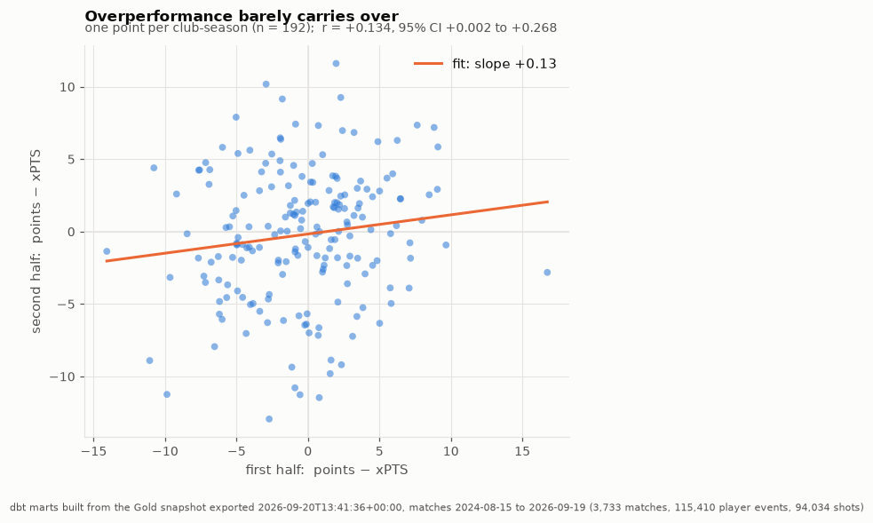
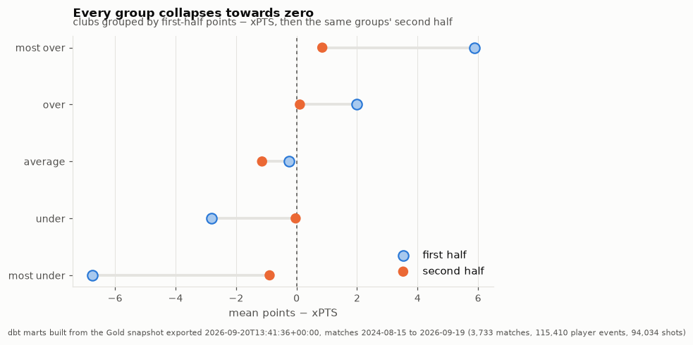
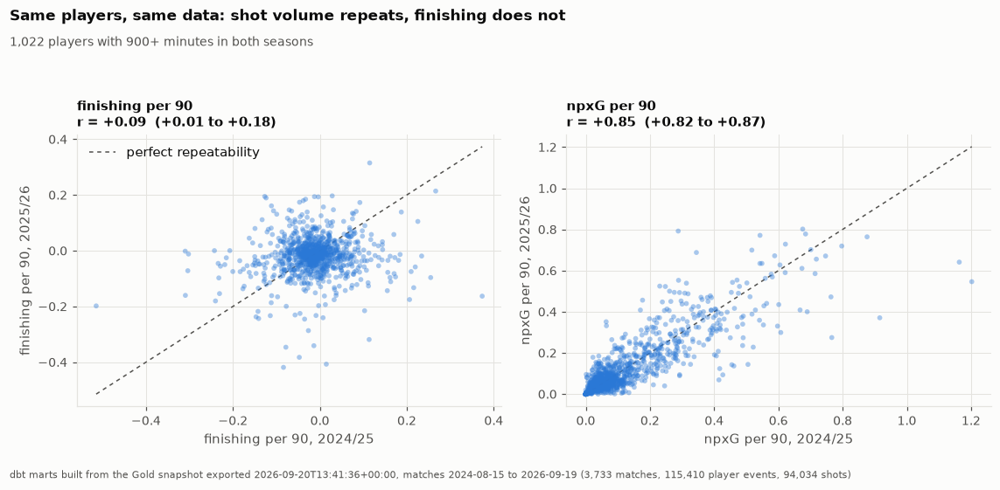
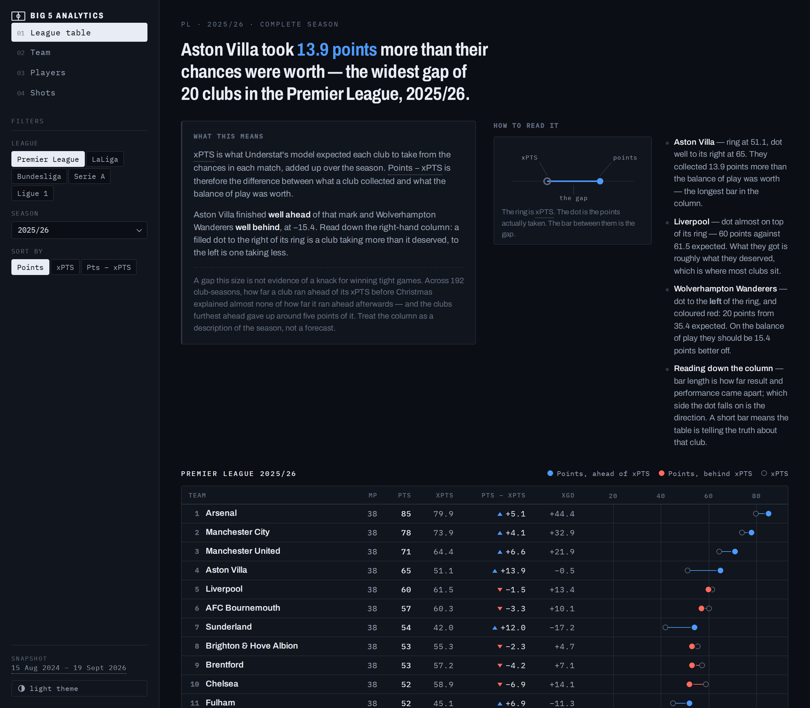
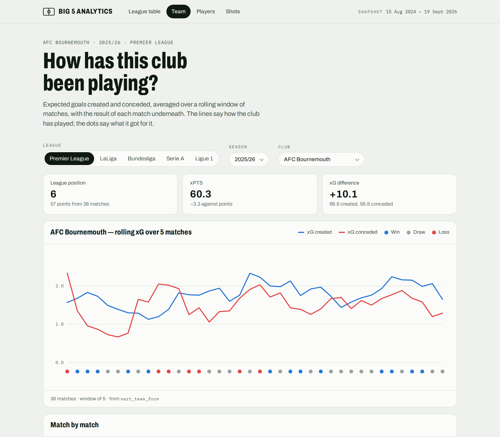
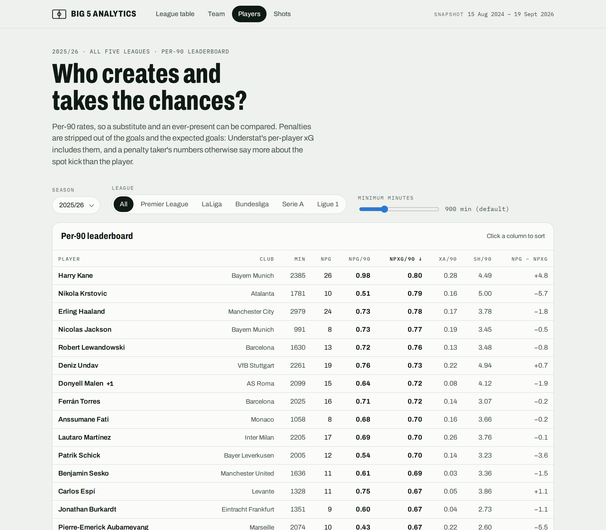
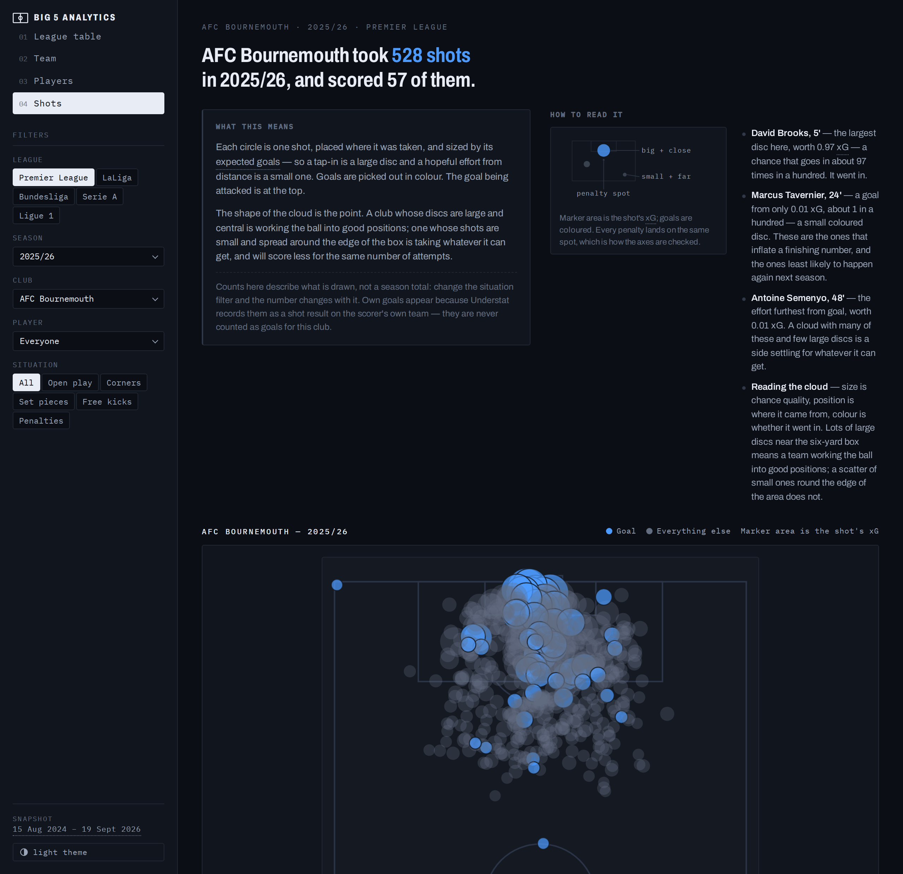

# Football Analytics — expected goals, and what they are worth

**Two questions about expected goals, answered from two complete seasons of the big-5
European leagues, with a tested metrics layer and a dashboard behind them.**

This is Part 2 of a three-part portfolio. Part 1 built the pipeline; this repository
turns its warehouse into answers.

| Part | Scope | Repository | Status |
|------|-------|------------|--------|
| 1 — Data Engineering | Ingestion, Airflow, Bronze/Silver/Gold, data quality | [`football-data-engineering`](../football-data-engineering) | Complete |
| **2 — Analytics & BI** | Metrics layer, analyses, dashboard | **this repository** | **Complete** |
| 3 — Machine Learning | Match outcome / xG models | separate, later | Not started |

**You do not need Part 1 to read this.** Every number comes from a pinned Parquet
snapshot, and CI runs against a synthetic fixture — a fresh clone needs no database
and no credentials.

---

## The findings

### 1. Points that run ahead of expected points do not stay ahead

Some clubs collect more points than their chances deserved. Is that a trait that
carries into the next stretch of matches, or a run that ends?

> **It ends.** Across **192 club-seasons**, a club's first-half points-over-xPTS gap
> correlates with its second-half gap at **r = +0.13, with a 95% interval that
> reaches zero**. The clubs furthest ahead at the halfway mark gave up around five
> points of gap — and around five *actual* points — in the second half. The clubs
> furthest behind recovered by about as much.



Grouping clubs by their first-half gap and following the same groups forward shows
the same thing from the other side. Every group lands on roughly zero:



The obvious follow-up — "so read xG instead of the table" — **does not hold up
either**, and that is the more interesting half of the answer:

> As a **single number**, first-half xG difference and xPTS are *not* distinguishably
> better than first-half points at tracking second-half points. Both paired-bootstrap
> intervals on the difference include zero.
>
> What xG difference *does* do is add information **on top of** points: with
> first-half points already in the model, first-half xG difference still carries a
> clearly non-zero coefficient, and explained variance in second-half points rises
> from **0.482 to 0.541**. The answer is "read both", not "xG wins".

→ [`notebooks/02_points_vs_xpts.ipynb`](notebooks/02_points_vs_xpts.ipynb)

### 2. Finishing is mostly noise — and two seasons cannot find the signal underneath

A player who scores more than their chances were worth is called a good finisher.
Does that repeat next season?

> **Barely.** Across **1,022 players** with 900+ minutes in both complete seasons,
> non-penalty finishing per 90 repeats at **r ≈ 0.10**. The *same players'* shot
> volume repeats at **r ≈ 0.90** and their npxG per 90 at **r ≈ 0.85** — so this is a
> noisy quantity, not a noisy dataset.

The control is the argument. Two panels, same players, same seasons, same source —
one measure sits on the diagonal and the other is a shapeless blob:



Restricting to players who actually shoot a lot was meant to settle whether a skill
hides underneath. It did not:

> The estimate clears zero at npxG ≥ 5 (133 players) but **not** at npxG ≥ 1
> (585 players — *more* statistical power), and is inconclusive at npxG ≥ 10
> (24 players). One threshold in three is not how a solid effect behaves, so it is
> reported as **"cannot distinguish a very small effect from none"** rather than as a
> discovery.
>
> For anything forward-looking, chance volume is the number to read: last season's
> npxG per 90 tracks next season's non-penalty goals per 90 at **r ≈ 0.78**, while
> last season's finishing is very slightly *negative*.

→ [`notebooks/03_is_finishing_repeatable.ipynb`](notebooks/03_is_finishing_repeatable.ipynb)

Before either analysis, [`notebooks/01_data_profile.ipynb`](notebooks/01_data_profile.ipynb)
establishes what is actually in the data — and corrected two documented assumptions
that would each have produced a plausible wrong number.

---

## The dashboard

Four static pages over the same tested marts, plus a fifth showing Part 3's match
predictions, in the shape of an analyst's console:
a left rail of filters beside the numbers, dark by default, mono-forward. No
framework, no build step, no charting library, and no request to any other host at
runtime — the fonts are vendored, so it works offline.

**Every page answers before it tabulates.** A sentence at the top states what the
current view shows, a *What this means* block explains the metric in plain words, and
a **How to read it** block teaches the picture: a labelled miniature of that page's
own visual, then two or three worked examples naming rows that are on screen —
*"Aston Villa: ring at 51.1, dot well to its right at 65 — the longest bar in the
column."* They are selected by sorting the loaded rows, so they follow the filters.

Rates carry their **league percentile** as a bar, because "0.78 npxG per 90" does not
tell a reader whether that is good — and the percentile is computed in dbt against a
stated population, not in the browser.

Hosting is an open decision ([§13](CLAUDE.md)): publishing the site publishes its
JSON, which is the data itself, and the source terms have not been settled. So these
are screenshots of the real thing, generated from the real pages.

| | |
|---|---|
| **League table** — points against xPTS, per league and season. A filled dot right of its ring means more points than the chances suggested. | **Team** — rolling xG created and conceded, with each match's result underneath. |
| [](docs/images/dashboard-league-table.png) | [](docs/images/dashboard-team.png) |
| **Players** — per-90 leaderboard with a minutes filter. Penalties stripped out. | **Shots** — every shot where it was taken, sized by xG, drawn as hand-written SVG in Understat's own coordinates. |
| [](docs/images/dashboard-players.png) | [](docs/images/dashboard-shots.png) |

**No metric is computed in the browser** — including the explanations. The frontend
filters, sorts and formats; every figure it shows, and every ranking or band it reads
out, was defined in dbt and tested there. A percentile depends on which players are
in the comparison, so it is a modelling decision, not a label. The rule is enforced
by the export script rather than left to discipline: it refuses to read any table
whose name does not begin with `mart_`.

---

## Why the numbers can be trusted

In this dataset a mistake produces a *plausible wrong number*, not an error. A league
table that is one match short still adds up. A player's season split across two clubs
still looks like a season. So the work went into making those failures loud.

**A schema contract.** `contracts/gold_columns.json` records every Gold column, type,
precision and nullability. The export **fails on any difference**, so a change
upstream surfaces at export time rather than as a wrong number in a chart.

**Fourteen documented traps, each measured against the real data** — and **two of
them turned out to be documented incorrectly**:

> **The status filter.** Filtering matches on `status = 'FINISHED'` silently drops
> three abandoned-then-**`AWARDED`** matches that were really played and really
> counted. Six clubs across three league-seasons then read **33 matches played in a
> 34-match season**.
>
> **The duplicated fixtures.** Twelve fixtures exist as two rows. They were documented
> as one row holding the result and one holding the xG — but **both are `FINISHED`
> and both carry the same scoreline**, so `status` does not separate them and a
> second, independent filter is needed. Without it a club plays 39 matches in a
> 38-match season.

Measuring the rest sharpened them. Own goals, for instance, are a *shot result* that
carries exactly 0.0000 xG and is not counted in Understat's own shot tally — so shot
rows equal reported shots plus own goals, exactly, on all 115,410 rows. That is now an
invariant the build checks, not a footnote.

**A synthetic fixture carrying every trap on purpose**, so a model that mishandles one
fails in CI rather than in production. Building it exposed that it had been giving
false confidence: it had no `AWARDED` match at all, and its penalties were placed by
an 8% random draw that produced *none* on some seeds — quietly removing the trap it
existed to guarantee.

**Tests that have been seen to fail.** Filtering on `FINISHED` alone, dropping the
duplicate-fixture filter, and `COALESCE`-ing xG to zero were each introduced on
purpose to confirm a test catches them. A test suite nobody has watched fail is a
decoration.

**Reconciliation against the real world**, not just against itself. 2024/25's final
tables are exact in all five leagues — Liverpool 84, Barcelona 88, Napoli 82, Bayern
82, PSG 84, with correct goal differences — and top scorers match: Mbappé 31, Salah
29 with 18 assists, Kane 26.

**16 dbt models · 131 dbt tests · 119 Python tests**, all green on the real snapshot
and on the fixture.

---

## How it is built

```
  Part 1 PostgreSQL  (gold.dim_*, gold.fact_*)
          │  scripts/export_gold.py — READ_ONLY attach + contract check
          ▼
  data/gold/*.parquet + manifest.json      exact copy, no transforms
          │  dbt build
          ▼
  data/analytics.duckdb
     stg_*    1:1 with Gold — renames and casts only
     int_*    team-per-match, player-per-match, deduplicated shots, club seasons
     mart_*   team season + half, team form, player season, shots
          │
          ├──► notebooks/   one question each
          │
          └──► scripts/export_site_data.py — marts only, READ_ONLY
                    │
                    ▼
               site/  static dashboard: HTML + CSS + JS over JSON
```

Two rules hold the design together. **A metric is defined once**, in dbt, and
everything else reads it — a calculation anywhere else means a mart is missing. And
**the snapshot is pinned**, so an analysis does not change its answer because the
pipeline loaded another day.

Why a Parquet snapshot rather than querying Part 1 live, why a static site rather than
Streamlit or Metabase, and why dbt for sixteen models: [`CLAUDE.md`](CLAUDE.md) §3 and
§6 give the reasoning, including the options rejected.

### The data

Big-5 European leagues — Premier League, LaLiga, Bundesliga, Serie A, Ligue 1 —
combining Football-Data.org results with Understat expected-goals measures.

The snapshot behind every number above holds **3,733 matches, 115,410 player events
and 94,034 shots**: the complete 2024/25 and 2025/26 seasons plus 2026/27 to date.
Every analysis cites its snapshot's exact export time and `match_date` range from
`manifest.json`.

---

## Run it yourself

```bash
uv sync --extra dev
```

Everything below works with no database except the export itself.

```bash
# --- tests, lint, format: no data required ------------------------------------
uv run pytest -q
uv run ruff check .
uv run black --check .

# --- work against the synthetic fixture instead of real data -----------------
export GOLD_SNAPSHOT_DIR=tests/fixtures/gold

# --- export a real snapshot (needs Part 1's database, nothing else) ----------
cp .env.example .env     # defaults match Part 1's docker-compose
(cd ../football-data-engineering && docker compose up -d postgres)
uv run python scripts/export_gold.py

# --- build the metrics layer (works on the fixture or a real snapshot) -------
uv run dbt build --project-dir dbt --profiles-dir dbt

# --- read the analyses --------------------------------------------------------
uv run jupyter lab

# --- the dashboard ------------------------------------------------------------
uv run python scripts/export_site_data.py    # marts -> site/data/*.json
uv run python scripts/serve_site.py          # then open http://127.0.0.1:8000
uv run python scripts/check_site.py          # confirm it is serving site/, not a stale copy
```

The pages fetch JSON, so opening the HTML files directly does not work. Use
`serve_site.py` rather than `python -m http.server`: the stock server sends no
`Cache-Control`, so browsers reuse cached JavaScript and a reload can quietly run
the previous build's scripts against the current markup.

The browser smoke tests run in Chromium and Firefox, need them installed once per
machine (`uv run playwright install --with-deps chromium firefox`), and skip
themselves without.

If Part 1's schema has changed, the export refuses to run and names every difference.
Review what it affects, then `uv run python scripts/export_gold.py --write-contract`
and commit that on its own.

---

## Layout

```
├── contracts/gold_columns.json   expected Gold schema; the export fails on drift
├── scripts/
│   ├── export_gold.py            Part 1 PostgreSQL -> Parquet snapshot + manifest
│   ├── export_site_data.py       marts -> site/data/*.json (marts only, enforced)
│   ├── serve_site.py             local preview that never serves a stale script
│   ├── check_site.py             compares a running server against site/ on disk
│   └── export_readme_images.py   charts from the notebooks, screenshots from the site
├── dbt/
│   ├── macros/                   season_label (Part 1's August cutoff), grain test
│   ├── models/{staging,intermediate,marts}/
│   └── tests/                    singular tests: a wrong filter fails here
├── notebooks/                    one question each, outputs committed
├── site/                         static dashboard: 5 pages, no framework
│   ├── css/app.css               the whole design system
│   ├── js/                       common.js + one file per page
│   └── vendor/fonts/             Archivo + IBM Plex Mono, vendored (OFL)
├── src/football_analytics/
│   ├── gold.py                   the contract, and drift detection
│   ├── snapshot.py               the Parquet snapshot loader
│   ├── marts.py                  the mart loader; refuses a stale database
│   ├── stats.py                  seeded bootstrap intervals
│   └── viz.py                    chart style and pitch plots
├── tests/
│   ├── fixtures/make_gold_fixture.py   the synthetic snapshot CI runs on
│   └── test_*.py
└── data/, site/data/             gitignored: snapshot, DuckDB store, dashboard JSON
```

---

## Scope and limits

- **Observational data.** Every finding is an association, never a cause.
- **Two complete seasons.** Enough to show a near-zero correlation clearly; not enough
  to rule out a small persistent effect, and not enough to say much league by league.
- **Understat's xG model** is the yardstick throughout. "More goals than expected"
  means more than *that model* expected; a systematic bias in it would appear here as
  a player trait, and nothing in the data can separate the two.
- **Not in the data at all:** possession, passes, tackles, and stadium city and
  capacity. No metric is designed around them, and nothing is imputed.
- **Predictive modelling is out of scope** — that is Part 3. This repository explains
  what happened; it does not forecast. Both analyses stop exactly where a train/test
  split would begin.
- **`data/` and `site/data/` are gitignored.** Football-Data.org and Understat each
  have terms of use, and whether any snapshot or dashboard JSON may be published is an
  open decision ([`CLAUDE.md`](CLAUDE.md) §13) — which is why the dashboard is built
  but not deployed. Until that is settled, CI runs on the synthetic fixture.

## What is next

Part 3 picks up exactly where question 1 stops: xG difference adds information about
the next half-season, so the question becomes whether it can *predict* unseen matches
— with a train/test split, a baseline to beat, and the same rule that every number is
defined once and tested. Predictions will reach the dashboard the same way these
numbers did: as pre-computed JSON, never a model running live.
